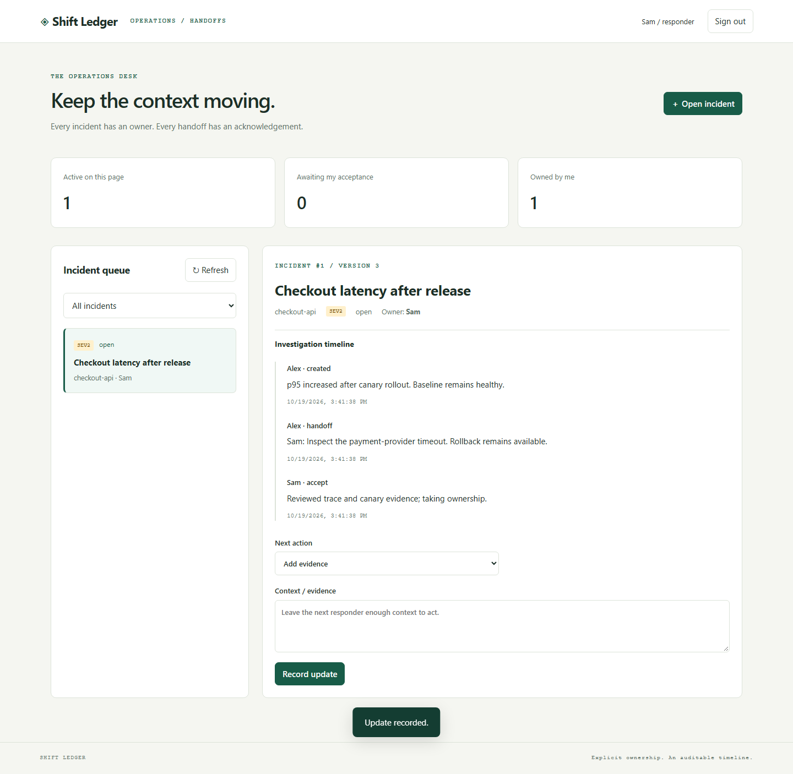
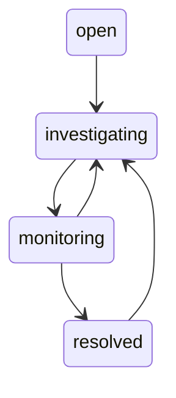

# Shift Ledger

[](https://github.com/nazek52/shift-ledger/actions/workflows/ci.yml)

An incident desk where ownership changes only after the next responder accepts the handoff. Every update has context, an actor, and a versioned audit event.

**FastAPI · SQLite transactions · browser UI · optimistic concurrency · RBAC**



[Русский разбор](docs/INTERVIEW.ru.md) · [Architecture](docs/architecture.md) · [Runbook](docs/runbook.md) · [Verification](docs/verification.md)

## Run locally

Python 3.13+. A dedicated virtual environment is recommended.

```sh
python -m pip install -r requirements.txt
python scripts/bootstrap.py
python scripts/run.py
```

Open <http://127.0.0.1:8012>. `.local-users.json` contains randomly generated login tokens for Alex, Sam, and a read-only observer. Paste a token into the login form. Existing configuration is never overwritten. The file and database are ignored by Git. The app binds to loopback.

1. Sign in as Alex and create an incident with initial evidence.
2. Request a handoff to Sam. Alex remains the owner while acceptance is pending.
3. In another browser session, sign in as Sam, review the timeline, and accept ownership.
4. Open the same incident in two tabs, update one, then submit from the stale tab. The API returns **409**; the UI reloads the timeline and preserves the draft note.

## Domain rules

Only responders can write. Only the current owner can change status or request/cancel a handoff. Only the requested recipient can accept it. Valid status flow:



A pending handoff blocks resolution. Every command requires a version and a nonempty note. State changes and the append-only application audit event commit in one transaction. Concurrent writers cannot silently overwrite one another. Incident lists use descending-ID cursor pagination.

## Verification

```sh
python -m pip install -r requirements-dev.txt
python -m pytest -q
npm ci
npx playwright install chromium
npm run test:browser
docker build -t shift-ledger:local .
```

Browser tests launch a temporary isolated database on port 8014. They do not read `.local-users.json` or touch the normal database. If Python is not on PATH, set `PYTHON` to your virtual environment's executable. Node.js 24 is needed only for browser tests; the UI is buildless.

## API and configuration

`GET /api/me`, `GET /api/responders`, `GET/POST /api/incidents`, `GET /api/incidents/{id}`, and `POST /api/incidents/{id}/commands`. Protected routes require a bearer token. Use `SHIFT_USERS` (JSON mapping token to `{name,role}`) and `SHIFT_DB` for custom configuration. `/health` checks DB access. The factory is `shift.api:create_app`.

## Scope

This is a single-team lab with operator-provisioned tokens. Tokens are kept only in browser session storage and are cleared on sign-out. There is no SSO, password flow, multi-tenancy, automatic polling, paging service, or external notification delivery. The audit log is append-only through this application, not cryptographically tamper-proof against a database administrator. No claim of production readiness is made. Public deployment requires TLS, an identity provider, request/rate limits, and an operational backup policy.

Personal, AI-assisted engineering project; [MIT](LICENSE).
